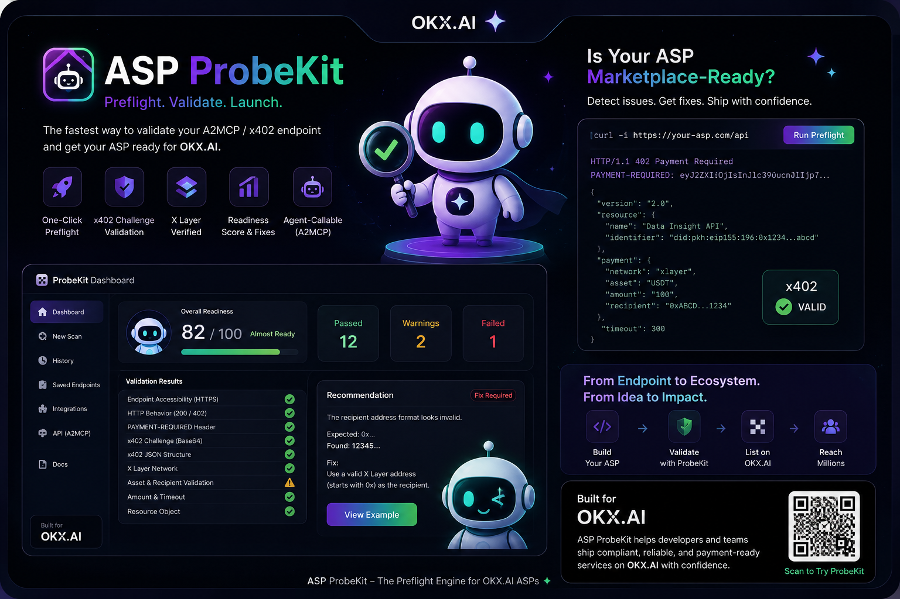
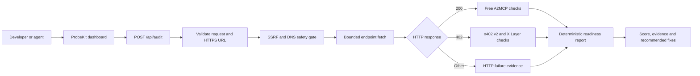
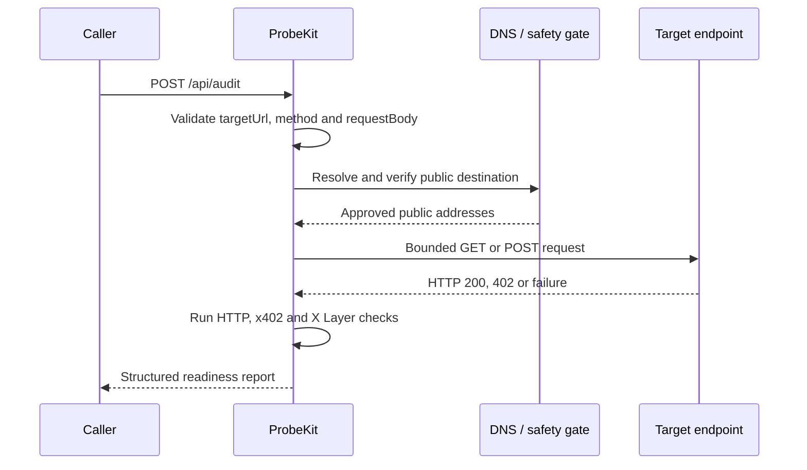

# ASP ProbeKit

### Test your ASP before the marketplace does.

[](https://probe-kit-flax.vercel.app)
[](https://www.okx.ai)
[](https://web3.okx.com/xlayer)
[](https://www.typescriptlang.org/)

**ASP ProbeKit is a production-ready preflight scanner for free and x402-powered A2MCP endpoints.** It catches protocol, networking, and payment-challenge failures before an Agent Service Provider reaches marketplace review - and turns every failure into an actionable fix.

[Launch ProbeKit](https://probe-kit-flax.vercel.app) | [Run an audit](https://probe-kit-flax.vercel.app/dashboard) | [Check service health](https://probe-kit-flax.vercel.app/api/health) | [View the API](#api-reference)



## The problem

An endpoint can work locally and still fail as an agent service: the URL may resolve to an unsafe destination, return the wrong status, omit a payment header, encode an invalid x402 challenge, or target the wrong network.

ProbeKit converts that uncertain review cycle into a repeatable preflight:

1. Submit a public HTTPS endpoint.
2. ProbeKit safely inspects its network and protocol behavior.
3. Receive a readiness score, evidence for every check, and concrete remediation.

## What ProbeKit validates

| Area | Validation |
| --- | --- |
| Connectivity | URL parsing, HTTPS enforcement, public DNS resolution, reachability and latency |
| HTTP behavior | Status code, redirects, response size and JSON structure |
| Free A2MCP | Direct HTTP `200` service responses |
| x402 v2 | HTTP `402`, `PAYMENT-REQUIRED`, Base64 decoding and challenge shape |
| X Layer | CAIP-2 network identifier `eip155:196` and payment-option fields |
| Security | Private-network blocking, redirect revalidation, timeouts and size limits |
| Developer experience | Deterministic score, evidence, warnings, failures and recommended fixes |

## Live demonstration

The dashboard includes deterministic fixtures so the complete audit workflow can be evaluated without a wallet or real payment:

| Scenario | Endpoint | Expected result |
| --- | --- | --- |
| Valid free service | `GET /api/demo/free` | HTTP `200` with structured JSON |
| Broken x402 service | `GET /api/demo/broken-x402` | HTTP `402` with a missing challenge |
| Valid x402 structure | `GET /api/demo/valid-x402` | Structurally valid x402 v2 challenge |

The valid x402 fixture validates protocol structure only. It does not request, sign, submit, or settle a payment.

## Architecture



### Audit lifecycle



## API reference

### Audit an endpoint

```http
POST /api/audit
Content-Type: application/json
```

```json
{
  "targetUrl": "https://probe-kit-flax.vercel.app/api/demo/free",
  "method": "GET"
}
```

`method` accepts `GET` or `POST` and defaults to `GET`. `requestBody` is an optional JSON object used only for POST audits.

Try it with cURL:

```bash
curl --request POST "https://probe-kit-flax.vercel.app/api/audit" \
  --header "Content-Type: application/json" \
  --data '{"targetUrl":"https://probe-kit-flax.vercel.app/api/demo/free","method":"GET"}'
```

Every audit returns:

- Endpoint type and HTTP status
- Readiness label and score
- Response time
- Passed checks, warnings and failures
- Expected and actual evidence
- Recommended fixes

### Health check

```http
GET /api/health
```

```json
{
  "status": "ok",
  "service": "ASP ProbeKit",
  "version": "1.0.0",
  "timestamp": "2026-07-27T10:00:00.000Z"
}
```

## Security by design

ProbeKit treats every submitted target as untrusted.

- Accepts HTTPS destinations only
- Resolves DNS before outbound requests
- Rejects private, loopback, link-local, reserved and metadata destinations
- Revalidates every redirect destination
- Allows at most three redirects
- Enforces a five-second request timeout
- Limits endpoint responses to 256 KB
- Limits audit requests to 32 KB
- Never forwards user-supplied authorization headers or cookies
- Never executes remote HTML
- Avoids returning secrets or full unbounded response bodies

ProbeKit validates payment-challenge structure; it does not pay challenges, sign authorizations, replay paid requests, or verify settlement.

## Run locally

### Requirements

- Node.js 20+
- Bun 1.3+
- Git

```bash
git clone https://github.com/ShivamSoni20/ProbeKit.git
cd ProbeKit
bun install --frozen-lockfile
bun run dev
```

Create the production build:

```bash
bun run build
```

Nitro generates the deployable server and public assets in `.output/`.

## Technology

`TanStack Start` | `React 19` | `TypeScript` | `Tailwind CSS` | `Zod` | `Radix UI` | `Nitro`

## OKX.AI Genesis Hackathon

ProbeKit was built for the **Software Services / Software Utility** category.

| Field | Value |
| --- | --- |
| ASP | ASP ProbeKit |
| OKX.AI identity | `#9642` |
| Registered service | Endpoint Readiness Audit |
| Service type | Free A2MCP API |
| Production endpoint | `https://probe-kit-flax.vercel.app/api/audit` |
| Core value | Find endpoint-readiness failures before marketplace listing |

## Project status

ProbeKit is deployed and operational. The current release focuses on deterministic endpoint preflight and structural x402 validation. Passing ProbeKit's independent checks improves readiness but does not guarantee OKX.AI marketplace approval.

## License

No open-source license has been selected. All rights are reserved unless a license is added to this repository.
